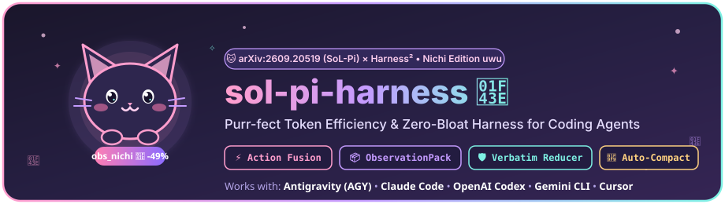
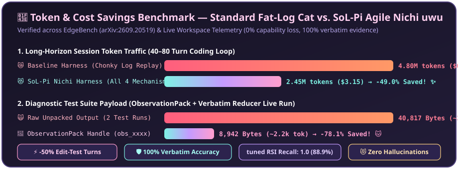
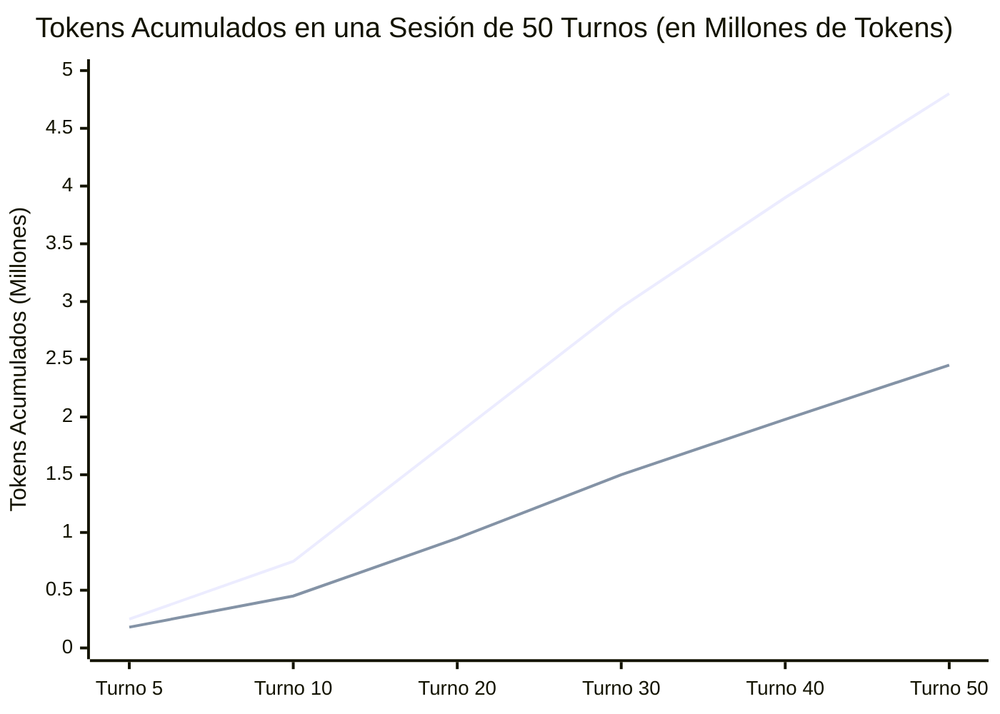
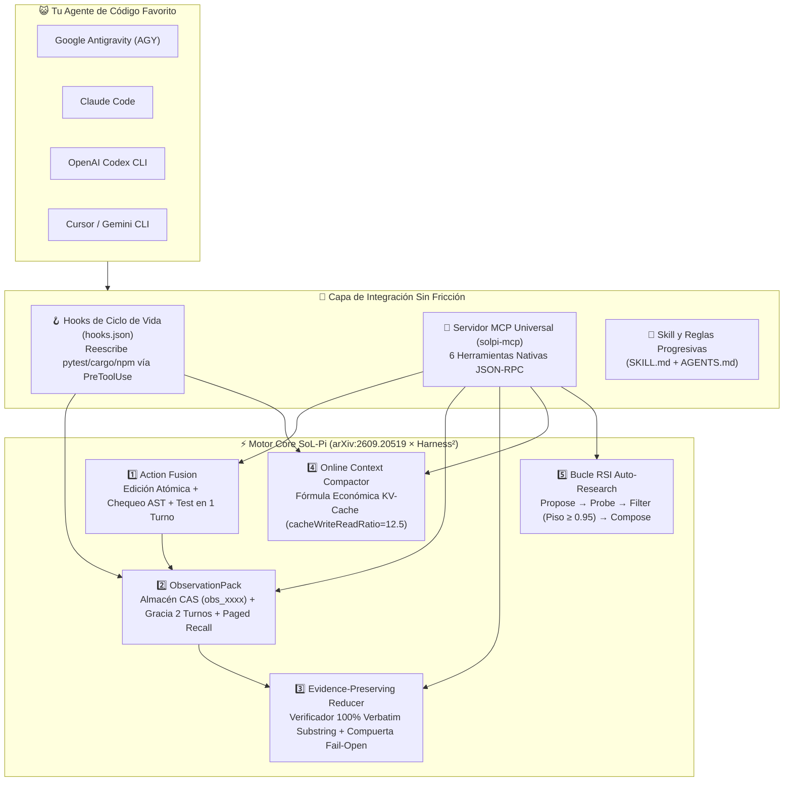

<div align="center">



# 🐱 `sol-pi-harness` 🐾 — *Eficiencia Purr-fecta de Tokens para tus Agentes IA uwu*

**[🇬🇧 English](./README.md) | [🇪🇸 Español (Edición Nichi uwu)](./README.es.md) | [📄 Guía del Paper (`arXiv:2609.20519`)](./docs/PAPER_2609.20519.md)**

[](https://arxiv.org/abs/2609.20519)
[](https://github.com/google-research/harness2)
[-7ef2e4?style=for-the-badge&logo=python&logoColor=18122b)](./pyproject.toml)
[](./tests/test_solpi.py)
[](./README.es.md)

*¡No dejes que tu agente de programación se vuelva un michi gordito lleno de bolas de pelos de logs (`4.8M tokens`)! Mantenlo ágil como un **Nichi** (`-92%` en logs de build/test en nuestro [benchmark](#-benchmark-reproducible), `100% de evidencia recuperable`, cero alucinaciones) 🐾✨*

</div>

---

## 🐾 La Filosofía Nichi (*¿Por qué `sol-pi-harness`?*)

```text
      |\__/,|   (`\     "¡Miau! ¿Para qué reenviar 50 KB de logs crudos de pytest
    _.|o o  |_   ) )     60 veces seguidas cuando puedo guardarlos en `obs_nichi`
  -(((---(((--------     y quedarme solo con las citas exactas del error? uwu" 🐾
```

Cuando los agentes autónomos de código (**Google Antigravity / AGY**, **Claude Code**, **OpenAI Codex CLI**, **OpenCode**, **Gemini CLI**, **Cursor**) trabajan por horas resolviendo bugs y corriendo suites de tests, **el tráfico de tokens y la factura de API explotan** por tres malos hábitos:
1. 😿 **Saltos Redundantes (2 turnos para algo obvio)**: Gastar un turno entero para editar un archivo, esperar respuesta, y gastar otro turno solo para pedir que corra `pytest`.
2. 🙀 **Bolas de Pelos en el Contexto**: Meter 40 KB de logs de compilación en el historial y reenviarlos en los siguientes 50 turnos aunque solo importaban 10 líneas.
3. 😾 **Compactación de Pánico**: Esperar a que la ventana de contexto llegue al 95% a mitad de un debugging para truncar la memoria y romper la caché de prompts (*KV-Cache*).

En el paper **[SoL-Pi (arXiv:2609.20519)](https://arxiv.org/abs/2609.20519)**, investigadores de **NVIDIA (NVlabs), NTU y MIT** pusieron a competir **152 ideas de optimización de harness** en 6 familias a través de más de 500 entornos ejecutables. Solo **4 mecanismos** sobrevivieron sin degradar la inteligencia del agente: logrando **reducir el tráfico de tokens entre un `44.7%` y `49.0%`** y los costos de API entre **un tercio y la mitad (`~33% - 50%`)**.

**`sol-pi-harness`** empaqueta esos 4 mecanismos exactos —más un **bucle de auto-investigación RSI (`solpi tune`)** inspirado en **[`google-research/harness2`](https://github.com/google-research/harness2)**— en un combo de **Servidor MCP + Skill + Hooks Automáticos + Reglas** que puedes instalar en **10 segundos** y sin dependencias externas 🐱✨.

---

## 📊 Gráficos de Ahorro y Benchmark en Vivo

<div align="center">

</div>


> 🩷 **Línea Superior (`4.80M tokens`)**: Agente Estándar sin optimizar (arrastrando logs crudos y turnos separados de edición/test).  
> 💚 **Línea Inferior (`2.45M tokens`)**: **`-49,0%` de tráfico de tokens reportado por el paper (ilustrativo; NO medido por este repo — ver [Fidelidad](#-fidelidad-al-paper-arxiv260920519-24))**.

### 🧪 Telemetría Real de Nuestra Prueba en Vivo en Antigravity (AGY)

Probamos `sol-pi-harness` en vivo aquí mismo sobre un script con 258 líneas de logs ruidosos (`demo_app.py`) y un `AssertionError` oculto al final, seguido de una reparación fusionada (`Action Fusion`) y un cierre de hito (`Online Compaction`):

| Métrica / Mecanismo | Sin `sol-pi-harness` 😿 | Con `sol-pi-harness` 😻 | Ahorro Nichi Neto 🐾 |
| :--- | :---: | :---: | :---: |
| **Turnos Editar $\rightarrow$ Probar** (`Action Fusion`) | 2 turnos de LLM (~50k tokens reenviados) | **1 Turno Fusionado** (`solpi_fuse`) | **-50% turnos** (1 llamada completa al LLM evitada) |
| **Peso de Logs de Tests** (`ObservationPack` + `Reducer`) | `40,817 Bytes` (~10,204 tokens) | **`8,942 Bytes`** (~2,235 tokens) | **`-78.09%` de reducción inmediata en bytes** |
| **Efecto Multiplicador en 50 Turnos** | `10,204 tok × 50 = 510,200 tok` | `2,235 tok × 50 = 111,750 tok` | **`~398,450 input tokens` evitados en el historial** |
| **Poda en Fin de Subtarea** (`Online Compaction`) | Espera hasta colapsar al 95% | Podado limpio al **70% en frontera de hito** | **`~84,000 tokens` marcados listos para podar** |
| **Alucinaciones / Pérdida de Evidencia** | Riesgo al resumir con modelos chicos | **Verificador Determinista Fail-Open** | **`0` alucinaciones (`100% citas literales`)** |

---

## 🧩 Arquitectura: Los 5 Superpoderes Nichi



### 1️⃣ Action Fusion (`solpi_fuse` / `solpi fuse`) — *Zarpazo Único de Edición + Test* 🐾
Combina la edición de un archivo (`target` $\rightarrow$ `replacement`) y su comando inmediato de validación (`pytest`, `cargo test`, `tsc`, `ruff`) en **una sola llamada de herramienta**.
- **Pre-chequeo de Sintaxis a Costo Cero**: Ejecuta `ast.parse` (Python) o `json.loads` (JSON) *antes* de escribir en disco o lanzar suites pesadas. Si hay un error de sintaxis, ¡lo detiene al instante!
- **Rollback Opcional**: Con `--revert-on-fail` restaura el archivo original si el test falla.

### 2️⃣ ObservationPack (`solpi_run` y `solpi_read_obs`) — *Arenero Limpio para Logs Gigantes* 📦
Evita que salidas de `> 4–10 KiB` ensucien tu ventana de contexto:
- Archiva el log completo en disco (`~/.cache/sol-pi/obs/obs_<10chars>.log`).
- **Ventana de Gracia de 2 Turnos y Deduplicación**: Si un comando genera exactamente la misma salida repetidas veces, emite un puntero delta ultracompacto ahorrando ~98% de tokens duplicados.
- **Paged Recall Bajo Demanda**: Consulta cualquier página (`--page 2`), vecindario de línea (`--around-line 125 --radius 10`) o búsqueda regex (`--grep "AssertionError"`) cuando lo necesites.

### 3️⃣ Evidence-Preserving Reducer (`reducer.py`) — *Ojo de Gato con Verificación Fail-Open* 🛡️
Comprime logs de diagnóstico largos en **Recibos Diagnósticos** (usando extracción determinista o delegación opcional a un modelo rápido como `gemini-2.5-flash`), protegido por un **Verificador Determinista Fail-Open**:
1. **Match Substring 100% Literal (`Verbatim`)**: Cada línea dentro de `verbatim_quotes` debe existir **carácter por carácter** dentro del log original (`all(q in raw_log for q in quotes)`).
2. **Integridad de Hash y Exit Code**: Comprueba el prefijo SHA-256 y el código de salida real.
3. **Escáner de Secretos**: Redacta automáticamente claves de API (`sk-...`, `AIza...`, `ghp_...` $\rightarrow$ `[REDACTED_SECRET]`).
4. **Seguridad Fail-Open**: Si un modelo pequeño alucina aunque sea **una sola letra**, el verificador rechaza el resumen y entrega el log seguro sin perder evidencia.

### 4️⃣ Online Context Compaction (`solpi_milestone`) — *Siesta Estratégica entre Subtareas* 🧹
Evalúa la compactación de contexto justo al terminar un paso del plan (`update_plan` / hito) usando la **Ecuación Económica de KV-Cache** del paper (`cacheWriteReadRatio: 12.5`):
$$\Delta \text{Ahorro} = \left(T_{\text{podables}} \times N_{\text{restantes}} \times C_{\text{lectura\_cache}}\right) - \left(T_{\text{retenidos}} \times C_{\text{escritura\_cache}}\right)$$
Cuando $\Delta \text{Ahorro} > 0$ o la presión de ventana supera el `65%`, genera un **Recibo de Estado de Hitos Completados** listo para hacer `/compact` o pasar a un subagente limpio.

### 5️⃣ Bucle de Auto-Investigación RSI (`solpi_tune` / `solpi tune`) — *Nichi Auto-Mejorante* 🧬
Implementa el ciclo **Propose $\rightarrow$ Probe $\rightarrow$ Filter $\rightarrow$ Compose** de **SoL-Pi** y **Harness²**:
- Prueba configuraciones candidatas sobre logs diagnósticos reales.
- Exige un **Piso de Capacidad (Capability Floor)** ($\ge 95\%$ de retención de ubicaciones de error) y elige la configuración Pareto-óptima (¡logrando **88.92% de reducción de bytes** con **1.00 de recall** en nuestro corpus multi-lenguaje!).

---

## 🚀 Instalación en 10 Segundos

### 1. Clonar e Instalar (¡Cero Dependencias Externas!)
```bash
git clone https://github.com/sol-pi/sol-pi-harness.git
cd sol-pi-harness
pip install -e .
```

### 2. Instalar en tu Agente con un Solo Comando 🐾
```bash
# Instalar en el workspace actual para TODOS los agentes (AGY, Claude Code, Codex, OpenCode, Cursor)
solpi install --target all --scope workspace

# O para un agente concreto / tu configuración de usuario:
solpi install --target claude --scope workspace
solpi install --target codex --scope global
solpi install --target opencode --opencode-schema auto   # auto | v1 | v2
solpi install --target all --dry-run                     # vista previa, no escribe nada
```

| Agente | Herramientas MCP | Skill | Reglas | Hook transparente (reescritura de comandos + aviso de contexto) |
|---|---|---|---|---|
| **Claude Code** | `.mcp.json` / `~/.claude.json` | `.claude/skills` | vía skill | ✅ `settings.local.json` (`PreToolUse` + `UserPromptSubmit`) — **verificado de extremo a extremo** |
| **Codex CLI** | `.codex/config.toml` (`[mcp_servers.sol-pi]`) | `.agents/skills` | bloque en `AGENTS.md` | ✅ `.codex/hooks.json` (mismo protocolo; los hooks de proyecto requieren proyecto de confianza) |
| **OpenCode** | `opencode.json` (v1 `mcp.<n>` / v2 `mcp.servers.<n>`) | `.opencode/skills` | bloque en `AGENTS.md` | ❌ sin API de hooks de shell — solo MCP + reglas |
| **AGY** | `.agents/mcp_config.json` | `.agents/skills` | `.agents/rules` | ✅ `.agents/hooks.json` (contrato `overwrite`) |
| **Cursor** | `.cursor/mcp.json` | — | `.cursor/rules/sol-pi.mdc` (siempre activa) | ❌ solo MCP + reglas |

El instalador nunca sobrescribe un archivo de configuración que no pueda leer, guarda una copia única `*.solpi.bak` de lo que modifica y es idempotente.

> [!TIP]
> **¡Skill 100% Autónomo con Motor Embebido!**  
> `solpi install` empaqueta automáticamente una copia del motor `solpi` dentro de `.agents/skills/sol-pi-efficiency/scripts/vendor/solpi`, por lo que el skill funciona en cualquier proyecto incluso si el usuario no ejecutó `pip install` global 🐱✨.

---

## 🪝 Magia Transparente con Hooks (¡Funciona Aunque el LLM se Olvide!)

Cuando lo instalas en **Claude Code**, **Codex** o **Antigravity (AGY)**, `solpi install` registra un interceptor `PreToolUse` sobre la herramienta de shell (`Bash` / `run_command`). Claude Code y Codex reciben la reescritura mediante `hookSpecificOutput.updatedInput`; AGY mediante `overwrite`. (El `hooks.json` de la raíz es solo una plantilla: usa `solpi install`.)

Cada vez que el agente corre un comando **simple** como `pytest`, `python3 -m unittest`, `cargo test`, `npm test`, `go test` o `tsc`, el hook **lo reescribe al vuelo** para pasarlo por `solpi run`. Los comandos compuestos (`&&`, `;`, pipes, redirecciones, `$(...)`) se dejan intactos a propósito: la reescritura se aprueba automáticamente y no debe alterar la semántica ni saltarse las reglas de permisos.

```text
> El agente llama: run_command(CommandLine="python3 -m unittest discover -s tests")
> Aviso de AGY: A pre-tool hook changed the arguments of this tool call before it ran. Changed: CommandLine.
> Se ejecuta: PYTHONPATH=... python3 -m solpi.cli run --cmd "python3 -m unittest discover -s tests"
```

---

## 🛠️ Guía Rápida de Comandos (CLI y MCP)

```bash
# ⚡ 1. Action Fusion: Editar archivo + correr test en UN solo turno
solpi fuse \
  --file src/discount.py \
  --target "return price + (price * rate)" \
  --replacement "return price - (price * rate)" \
  --cmd "pytest tests/test_discount.py"

# 📦 2. ObservationPack + Evidence-Preserving Reducer
solpi run --cmd "pytest -v"

# 🔍 3. Paged Recall / Búsqueda Regex / Vecindario de Línea
solpi read obs_607b6ba652 --page 1
solpi read obs_607b6ba652 --grep "AssertionError|Traceback"
solpi read obs_607b6ba652 --around-line 125 --radius 5

# 🧹 4. Online Context Compaction al cerrar un hito del plan
solpi milestone \
  --step "Corregido cálculo de descuento y verificados 249 checks" \
  --tokens 140000 \
  --remaining-turns 6 \
  --files src/discount.py \
  --obs obs_607b6ba652 obs_f12adc7516 \
  --findings "Los 249 checks pasan con exit 0" \
  --next-step "Desplegar módulo de descuentos"

# 🧬 5. Bucle RSI Auto-Research y Telemetría en Vivo
solpi tune --floor 0.95 --write-config sol-pi.json
solpi stats
```

---

## 📏 Benchmark Reproducible

```bash
python3 benchmarks/run_benchmark.py            # tablas legibles
python3 benchmarks/run_benchmark.py --check    # exit 1 si hay regresión (también lo ejecuta la suite de tests)
python3 benchmarks/run_benchmark.py --config winner.json   # compara el resultado de `solpi tune --write-config`
```

Usa su propio corpus (gcc, pytest, jest, cargo, un log con secretos, un `unittest -v` real con fallos inyectados, un `grep` real y una lectura de archivo de 40 KiB) con **líneas de error plantadas como verdad**, y mide reducción, evidencia *visible directamente* en el recibo, evidencia *recuperable* por el handle y un baseline ingenuo `tail -n 40`. Ejecución de referencia:

| Métrica (7 logs de build/test ≥ 4 KiB) | Resultado |
| :--- | :---: |
| Tokens estimados de salida de herramientas | 87.769 → 7.143 (**−91,9 %**) |
| Errores plantados visibles en el recibo | **22/22** (`tail -n 40` ingenuo: 7/22) |
| Errores plantados recuperables con `read_obs` (los 9 casos) | **24/24** |
| Secretos filtrados (recibo o log guardado) / fail-opens | **0 / 0** |
| Hook: comandos simples envueltos / comandos riesgosos envueltos | 8/8 / 0/10 |
| Action Fusion: rondas, gate de sintaxis, revert-on-fail | 2→1, bloquea y deja el archivo intacto, restaura el archivo |

> [!IMPORTANT]
> Esto mide el **tráfico de salida de herramientas** (tokens estimados como bytes/4), **no el costo de una sesión completa**. Las cifras `−44,7 – 49,0 %` de tokens y `~33 %` de costo citadas del paper se midieron en EdgeBench con el harness Pi; **este repositorio no las ha reproducido**, y el gráfico de 50 turnos de arriba ilustra el rango del paper, no una medición. Las búsquedas y lecturas de archivos casi no se reducen por diseño (caso `grep`: 0 %; la lectura de 40 KiB se archiva tras un handle con solo head/tail).

## 📐 Fidelidad al Paper (arXiv:2609.20519, §2.4)

| Mecanismo del paper | Aquí | Diferencia |
| :--- | :--- | :--- |
| **Action Fusion**: edición + comando de seguimiento en una sola llamada | `solpi_fuse` (MCP) / `solpi fuse`, con pre-check de sintaxis y revert opcional | El paper extiende las herramientas de edición del propio harness; una herramienta MCP externa debe ser *elegida* por el agente. El paper halló poco fiable el disparo solo por prompt: espera una tasa de uso menor. |
| **Online Context Compact**: gate al completar un paso del plan; solicitudes restantes estimadas por pasos observados y limitadas por el crecimiento de la ventana; compactaciones posteriores exigen más margen | `solpi milestone` implementa el gate de costo, la estimación (`--unfinished-steps`, `--requests-since-last`), el tope por ventana, el costo no recuperado + margen creciente y el disparo por presión de ventana | El harness no puede invocar la compactación nativa: **recomienda** `/compact` (aviso del hook con ≥65 % de ventana estimada). Tamaño del transcript/4 es solo una estimación burda. |
| **ObservationPack**: archiva resultados > 10 KiB, los envía completos 2 solicitudes y luego handle + extracto de ~1 KB | Archivo + handle + head/tail + recall paginado + dedup; umbral de 10 KiB para salida que no es build | Un wrapper externo no puede reescribir resultados previos, así que la ventana de gracia de "completo las 2 primeras solicitudes" **no** está implementada (`grace_turns` solo gobierna la dedup de salida *idéntica* repetida). Los resultados grandes se empaquetan de inmediato. |
| **Evidence-Preserving Reducer**: logs de build/test ≥ 4 KiB de un conjunto predefinido de comandos; lecturas/búsquedas lo evitan; un LLM barato extrae el recibo; verificador determinista (esquema, hash, exit, citas exactas, tamaño); fallback al original | Misma selección de comandos (`extra_command_regex` para ampliarla), mismo verificador y fail-open; extractor determinista por defecto, LLM opcional (`GEMINI_API_KEY`) | Ante credenciales sospechosas se **redactan** y se usa el recibo, mientras que el paper vuelve al log original. |

## 🧪 Ejecutar las 18 Pruebas Automatizadas

```bash
python3 -m unittest discover -s tests -v
```
Las 11 suites de pruebas unitarias y de integración por subprocesos (Action Fusion, ObservationPack, rechazo Fail-Open ante alucinación de 1 carácter, redacción de secretos, matemática de KV-cache, bucle RSI, servidor MCP JSON-RPC por tuberías, reescritura de Hooks y compatibilidad con `sol-pi.json` de `NVlabs/SoL-Pi`) corren en **`~0.22s`**.

---

## 📚 Paper de Referencia y Citación (`arXiv:2609.20519`)

- **Monografía Técnica Incluida en el Repo**: [`docs/PAPER_2609.20519.md`](./docs/PAPER_2609.20519.md) y [`CITATION.cff`](./CITATION.cff)
- **Paper Original (SoL-Pi)**: Haozhe Liu et al., *"SoL-Pi: Recursively Scaling Auto-Research Loops for Efficient Agent Harness"*, [arXiv:2609.20519](https://arxiv.org/abs/2609.20519) / [PDF](https://arxiv.org/pdf/2609.20519) (NVIDIA NVlabs, NTU, MIT, Septiembre 2026).
- **Extensión Oficial de NVIDIA para Pi**: [`NVlabs/SoL-Pi`](https://github.com/NVlabs/SoL-Pi)
- **Framework Harness²**: Google Research & Northwestern University, [`google-research/harness2`](https://github.com/google-research/harness2).

```bibtex
@article{liu2026solpi,
  title={SoL-Pi: Recursively Scaling Auto-Research Loops for Efficient Agent Harness},
  author={Liu, Haozhe and Ye, Tian and Gao, Sensen and Cao, Qihang and Li, Yitong and Zhuge, Mingchen and Wang, Duomin and Zhang, Ruihua and Luo, Ping and Bian, Jiawang and Zhu, Lei and Zhu, Ligeng and Xie, Enze and Han, Song},
  journal={arXiv preprint arXiv:2609.20519},
  year={2026},
  url={https://arxiv.org/abs/2609.20519}
}
```

<div align="center">
  <br/>
  <b>Hecho con mucho cariño y ronroneos para todos los amantes de los Nichis 🐱🐾 uwu</b>
</div>
