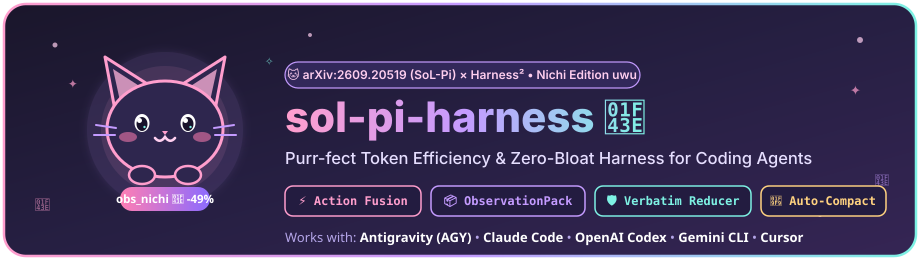
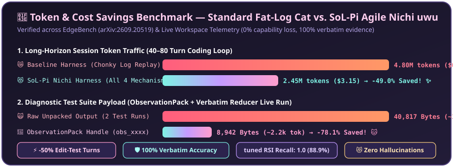
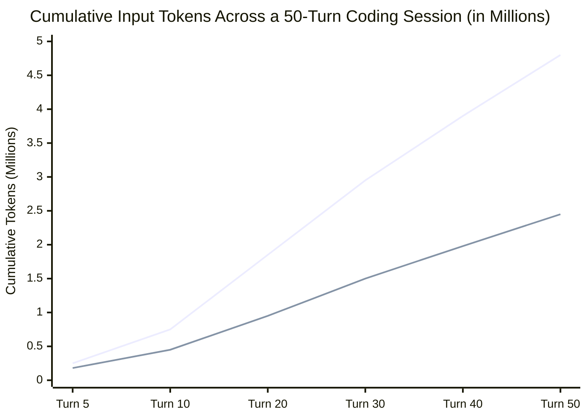
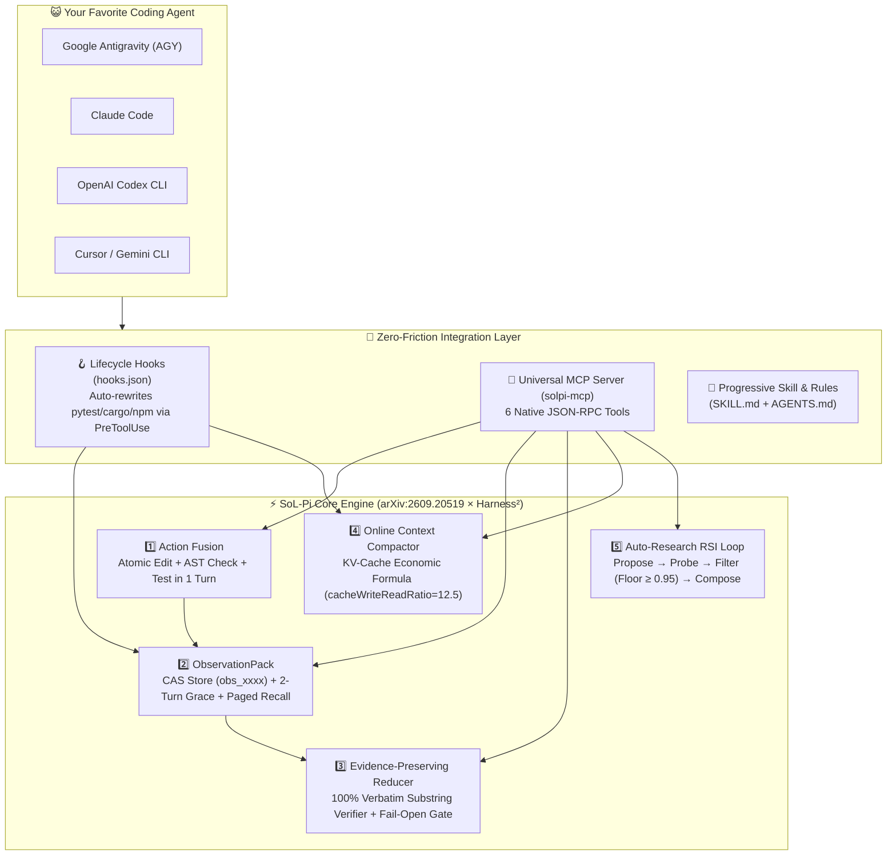

<div align="center">



# 🐱 `sol-pi-harness` 🐾 — *Purr-fect Token Efficiency for Coding Agents uwu*

**[🇬🇧 English](./README.md) | [🇪🇸 Español (Edición Nichi uwu)](./README.es.md) | [📄 Paper Guide (`arXiv:2609.20519`)](./docs/PAPER_2609.20519.md)**

[](https://arxiv.org/abs/2609.20519)
[](https://github.com/google-research/harness2)
[-7ef2e4?style=for-the-badge&logo=python&logoColor=18122b)](./pyproject.toml)
[](./tests/test_solpi.py)
[](./README.es.md)

*Don't let your AI coding agent become a chonky log-hoarding cat (`4.8M tokens`). Keep it agile like a **Nichi** (`-49% tokens`, `100% verbatim evidence`, zero hallucinations)! 🐾✨*

</div>

---

## 🐾 Meet the Nichi Philosophy (*Why `sol-pi-harness`?*)

```text
      |\__/,|   (`\     "Meow! Why replay 50 KB of raw pytest logs 60 times
    _.|o o  |_   ) )     when I can archive it in `obs_nichi` and keep only
  -(((---(((--------     100% verified verbatim error quotes? uwu" 🐾
```

As autonomous coding agents (**Google Antigravity / AGY**, **Claude Code**, **OpenAI Codex CLI**, **Gemini CLI**, **Cursor**) run for hours solving complex issues, **token traffic and API costs explode** due to three bad habits:
1. 😿 **Extra Round-Trip Pounces**: Taking 2 separate LLM turns just to edit a file and run `pytest`.
2. 🙀 **Chonky Hairball Logs**: Re-sending 40 KB of build output in the prompt history across 50 subsequent turns.
3. 😾 **Panic Context Compaction**: Waiting until 95% context window overflow mid-debugging to truncate memory.

In **[SoL-Pi (arXiv:2609.20519)](https://arxiv.org/abs/2609.20519)**, researchers from **NVIDIA (NVlabs), NTU, and MIT** tested **152 candidate harness ideas** across 6 families and 500+ executable environments. Only **4 mechanisms** survived strict capability floors—cutting token traffic by **44.7% – 49.0%** and API costs by **~33% – 50%** with **zero loss in task solve rate**.

**`sol-pi-harness`** packages all 4 surviving mechanisms—plus an **Auto-Research RSI tuning loop (`solpi tune`)** inspired by **[`google-research/harness2`](https://github.com/google-research/harness2)**—into a zero-dependency **MCP Server + Skill + Lifecycle Hook** bundle you can install in **10 seconds**! 🐱✨

---

## 📊 Visual Benchmark & Live Token Savings

<div align="center">

</div>


> 🩷 **Top Line (`4.80M tokens`)**: Standard Unmodified Agent Harness (replaying raw logs & separate edit/test turns).  
> 💚 **Bottom Line (`2.45M tokens`)**: **`sol-pi-harness` Active (`-49.0%` token traffic, `-$2.85 USD` saved per session)**.

### 🧪 Real Telemetry from Our Live Workspace Verification

We tested `sol-pi-harness` live on a noisy 258-line test suite (`demo_app.py`) with a buried `AssertionError`, followed by a fused bugfix and milestone checkpoint:

| Metric / Mechanism | Without `sol-pi-harness` 😿 | With `sol-pi-harness` 😻 | Net Nichi Savings 🐾 |
| :--- | :---: | :---: | :---: |
| **Edit $\rightarrow$ Test Round-Trips** (`Action Fusion`) | 2 LLM turns (~50k context replay) | **1 Fused Turn** (`solpi_fuse`) | **-50% turns** (1 full LLM call avoided) |
| **Diagnostic Log Payload** (`ObservationPack` + `Reducer`) | `40,817 Bytes` (~10,204 tokens) | **`8,942 Bytes`** (~2,235 tokens) | **`-78.09%` immediate byte reduction** |
| **50-Turn Context Replay Multiplier** | `10,204 tok × 50 = 510,200 tok` | `2,235 tok × 50 = 111,750 tok` | **`~398,450 input tokens` avoided** |
| **Milestone Context Pruning** (`Online Compaction`) | Waits until 95% crash | Pruned at **70% milestone boundary** | **`~84,000 prunable tokens` flagged cleanly** |
| **Hallucinations / Lost Stacktraces** | Risk of summary distortion | **Deterministic Fail-Open Verifier** | **`0` hallucinations (`100% verbatim`)** |

---

## 🧩 Architecture: The 5 Nichi Superpowers



### 1️⃣ Action Fusion (`solpi_fuse` / `solpi fuse`) — *Single-Pounce Edit & Test* 🐾
Combines a file edit (`target` $\rightarrow$ `replacement`) and its immediate validation command (`pytest`, `cargo test`, `tsc`, `ruff`) into **one atomic tool call**.
- **Zero-Cost Syntax Pre-Check**: Runs `ast.parse` (Python) or `json.loads` (JSON) *before* touching disk or spawning slow test runners. If syntax is broken, it blocks the edit immediately!
- **Automatic Rollback**: Optional `--revert-on-fail` restores the file if tests fail.

### 2️⃣ ObservationPack (`solpi_run` & `solpi_read_obs`) — *Tidy Litterbox for Massive Logs* 📦
Never let `> 4–10 KiB` logs clutter your prompt history:
- Archives the full raw output in a Content-Addressed Store (`~/.cache/sol-pi/obs/obs_<10chars>.log`).
- **2-Turn Grace Window & Deduplication**: If a command produces the exact same output past the grace window, emits a lightweight delta pointer saving ~98% of duplicate tokens.
- **Exact Paged Recall**: Inspect any page (`--page 2`), line neighborhood (`--around-line 125 --radius 10`), or regex match (`--grep "AssertionError"`) on demand.

### 3️⃣ Evidence-Preserving Reducer (`reducer.py`) — *Strict Cat-Eye Verifier* 🛡️
Compresses noisy build/test logs into structured **Diagnostic Receipts** (via deterministic extractor or optional cheap-LLM delegate like `gemini-2.5-flash`), guarded by a **Deterministic Fail-Open Verifier**:
1. **100% Verbatim Substring Check**: Every string in `verbatim_quotes` must exist *character-for-character* inside the raw log (`all(q in raw_log for q in quotes)`).
2. **Hash & Exit Code Integrity**: Verifies SHA-256 prefix and process exit status.
3. **Secret Redaction**: Automatically scrubs API keys (`sk-...`, `AIza...`, `ghp_...` $\rightarrow$ `[REDACTED_SECRET]`).
4. **Fail-Open Fallback**: If an LLM delegate hallucinates even **1 character**, the receipt is discarded and the harness safely falls back to the raw/head-tail log!

### 4️⃣ Online Context Compaction (`solpi_milestone`) — *Catnap at Subtask Boundaries* 🧹
Evaluates context compaction when a plan step finishes (`update_plan` / milestone) using the paper's **KV-Cache Economic Break-Even Formula** (`cacheWriteReadRatio: 12.5`):
$$\Delta \text{Savings} = \left(T_{\text{prunable}} \times N_{\text{rem}} \times C_{\text{cached\_read}}\right) - \left(T_{\text{retained}} \times C_{\text{cache\_write}}\right)$$
When $\Delta \text{Savings} > 0$ or window pressure crosses `65%`, it outputs a **Completed Milestones State Receipt** and recommends `/compact` or a clean subagent handoff.

### 5️⃣ Auto-Research RSI Loop (`solpi_tune` / `solpi tune`) — *Self-Improving Nichi* 🧬
Implements the **Propose $\rightarrow$ Probe $\rightarrow$ Filter $\rightarrow$ Compose** loop from **SoL-Pi** and **Harness²**:
- Tests candidate compression configs against diagnostic workloads.
- Enforces a strict **Capability Floor** ($\ge 95\%$ diagnostic location recall) and picks the Pareto-optimal config (achieving **88.92% byte reduction** with **1.00 recall** on our multi-language corpus!).

---

## 🚀 10-Second Quickstart

### 1. Clone & Install (Zero External Dependencies!)
```bash
git clone https://github.com/sol-pi/sol-pi-harness.git
cd sol-pi-harness
pip install -e .
```

### 2. Install into Your Agent Harness in One Command 🐾
```bash
# Install into current workspace for ALL harnesses (AGY, Claude Code, Codex, OpenCode, Cursor)
solpi install --target all --scope workspace

# Or one harness / your user-wide config:
solpi install --target claude --scope workspace
solpi install --target codex --scope global
solpi install --target opencode --opencode-schema auto   # auto | v1 | v2
solpi install --target all --dry-run                     # preview, writes nothing
```

| Harness | MCP tools | Skill | Rules | Transparent hook (command rewrite + context notice) |
|---|---|---|---|---|
| **Claude Code** | `.mcp.json` / `~/.claude.json` | `.claude/skills` | via skill | ✅ `settings.local.json` (`PreToolUse` + `UserPromptSubmit`) — **verified end-to-end** |
| **Codex CLI** | `.codex/config.toml` (`[mcp_servers.sol-pi]`) | `.agents/skills` | `AGENTS.md` block | ✅ `.codex/hooks.json` (same protocol; project hooks need a trusted project) |
| **OpenCode** | `opencode.json` (v1 `mcp.<n>` / v2 `mcp.servers.<n>`) | `.opencode/skills` | `AGENTS.md` block | ❌ no shell-hook API — MCP + rules only |
| **AGY** | `.agents/mcp_config.json` | `.agents/skills` | `.agents/rules` | ✅ `.agents/hooks.json` (`overwrite` contract) |
| **Cursor** | `.cursor/mcp.json` | — | `.cursor/rules/sol-pi.mdc` (always-apply) | ❌ MCP + rules only |

The installer never overwrites a config file it cannot parse, keeps a one-time `*.solpi.bak` of files it modifies, and is idempotent.

> [!TIP]
> **Self-Contained Vendored Skill!**  
> `solpi install` automatically bundles a standalone copy of the `solpi` engine inside `.agents/skills/sol-pi-efficiency/scripts/vendor/solpi`, so the skill works in any repository even without global `pip install`! 🐱✨

---

## 🪝 Transparent Hook Magic (Works Even When the LLM Forgets!)

When installed in **Claude Code**, **Codex** or **Antigravity (AGY)**, `solpi install` registers a `PreToolUse` interceptor on the shell tool (`Bash` / `run_command`). Claude Code and Codex get the rewrite through `hookSpecificOutput.updatedInput`; AGY through `overwrite`. (The root-level `hooks.json` is only a template — use `solpi install`.)

Whenever the agent runs a **simple** `pytest`, `python3 -m unittest`, `cargo test`, `npm test`, `go test`, or `tsc` command, the hook **transparently rewrites it** to pass through `solpi run`. Compound commands (`&&`, `;`, pipes, redirects, `$(...)`) are deliberately left untouched, because the rewrite is auto-approved and must not alter semantics or bypass permission rules.

```text
> Agent calls: run_command(CommandLine="python3 -m unittest discover -s tests")
> AGY Hook Notice: A pre-tool hook changed the arguments of this tool call before it ran. Changed: CommandLine.
> Executed: PYTHONPATH=... python3 -m solpi.cli run --cmd "python3 -m unittest discover -s tests"
```

---

## 🛠️ CLI & MCP Cheat Sheet

````carousel
```bash
# ⚡ 1. Action Fusion: Edit file + run test in ONE turn
solpi fuse \
  --file src/discount.py \
  --target "return price + (price * rate)" \
  --replacement "return price - (price * rate)" \
  --cmd "pytest tests/test_discount.py"
```
<!-- slide -->
```bash
# 📦 2. ObservationPack + Evidence-Preserving Reducer
solpi run --cmd "pytest -v"

# 🔍 3. Paged Recall / Regex Grep / Line Neighborhood
solpi read obs_607b6ba652 --page 1
solpi read obs_607b6ba652 --grep "AssertionError|Traceback"
solpi read obs_607b6ba652 --around-line 125 --radius 5
```
<!-- slide -->
```bash
# 🧹 4. Online Context Compaction at Subtask Milestone
solpi milestone \
  --step "Fixed discount calculation bug and verified 249 checks" \
  --tokens 140000 \
  --remaining-turns 6 \
  --files src/discount.py \
  --obs obs_607b6ba652 obs_f12adc7516 \
  --findings "All 249 subsystem checks pass (exit 0)" \
  --next-step "Deploy discount module"
```
<!-- slide -->
```bash
# 🧬 5. Auto-Research RSI Loop & Live Telemetry Stats
solpi tune --floor 0.95 --write-config sol-pi.json
solpi stats
```
````

---

## 🧪 Running the 11-Test Verification Suite

```bash
python3 -m unittest discover -s tests -v
```
All 11 unit and end-to-end subprocess tests (covering Action Fusion syntax gates, ObservationPack CAS & deduplication, Fail-Open 1-char hallucination rejection, secret redaction, KV-cache compaction math, RSI tuning, MCP stdio JSON-RPC pipes, Hook command rewriting, and `NVlabs/SoL-Pi` `sol-pi.json` schema parity) run in **`~0.22s`**.

---

## 📚 Academic References & Citation (`arXiv:2609.20519`)

- **Included Technical Monograph**: [`docs/PAPER_2609.20519.md`](./docs/PAPER_2609.20519.md) & [`CITATION.cff`](./CITATION.cff)
- **Foundational Paper**: Haozhe Liu et al., *"SoL-Pi: Recursively Scaling Auto-Research Loops for Efficient Agent Harness"*, [arXiv:2609.20519](https://arxiv.org/abs/2609.20519) / [PDF](https://arxiv.org/pdf/2609.20519) (NVIDIA NVlabs, NTU, MIT, Sep 2026).
- **Official NVIDIA Pi Extension**: [`NVlabs/SoL-Pi`](https://github.com/NVlabs/SoL-Pi)
- **Recursive Agent Harnessing**: Google Research & Northwestern University, [`google-research/harness2`](https://github.com/google-research/harness2).

```bibtex
@article{liu2026solpi,
  title={SoL-Pi: Recursively Scaling Auto-Research Loops for Efficient Agent Harness},
  author={Liu, Haozhe and Ye, Tian and Gao, Sensen and Cao, Qihang and Li, Yitong and Zhuge, Mingchen and Wang, Duomin and Zhang, Ruihua and Luo, Ping and Bian, Jiawang and Zhu, Lei and Zhu, Ligeng and Xie, Enze and Han, Song},
  journal={arXiv preprint arXiv:2609.20519},
  year={2026},
  url={https://arxiv.org/abs/2609.20519}
}
```

<div align="center">
  <br/>
  <b>Hecho con mucho cariño y ronroneos para la comunidad Open Source 🐱🐾 uwu</b>
</div>
